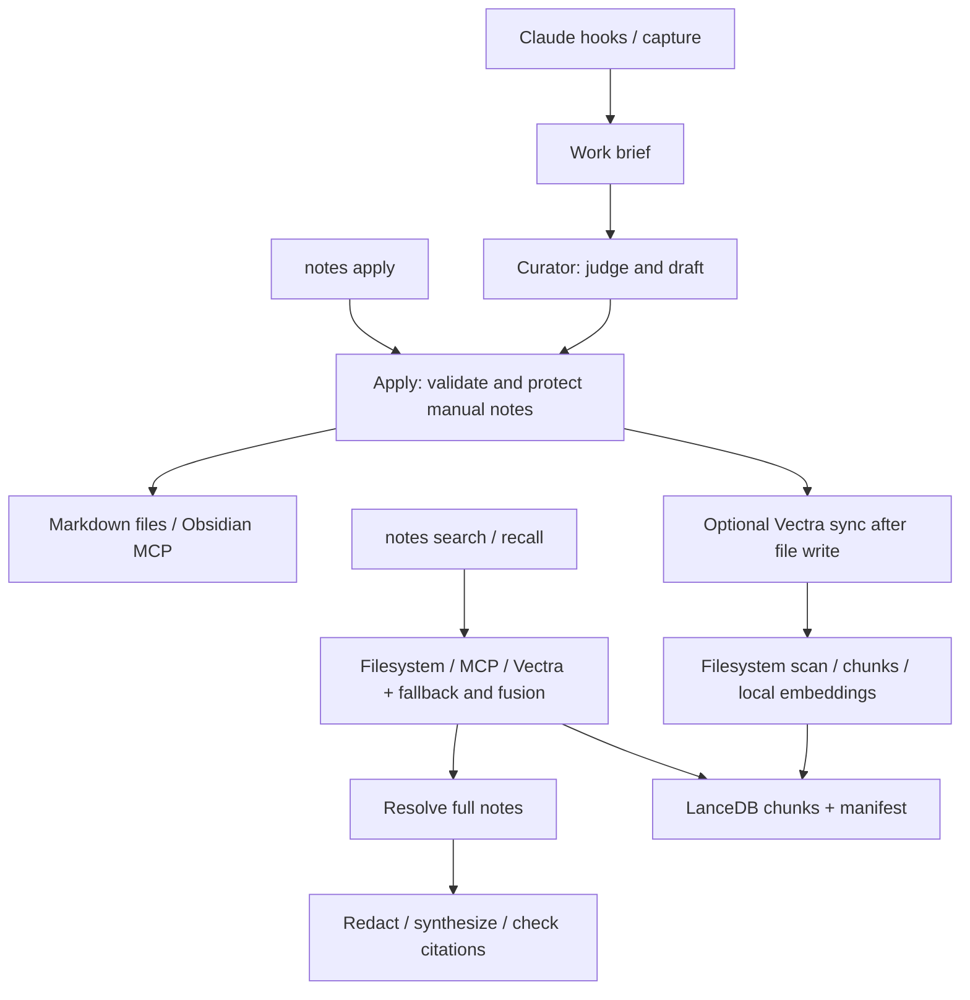

# Noesis and Vectra: verified implementation and proposed direction

2026-11-13. Audit base: Noesis `b3aab66`, Vectra `731cc23`.
Repositories: `/home/phzamora/Desktop/noesis`, `/home/phzamora/Desktop/vectra`.
Both working trees were clean before this work. The complete engineering handoff was
read, including its historical appendices. No graphify index exists in either checkout;
the observations below come from source, history, CLI help and executable tests.

## Product and boundaries

The objective is persistent agent learning: a fresh session can discover Noesis, retrieve
applicable guidance and its evidence, check recommended skills/tools in its own runtime,
perform work, and capture what happened so another session benefits.

There are three distinct write intentions: intentional knowledge capture, historical
experience capture, and consolidation/review. Observing something does not approve a
convention. A failed attempt is evidence in context, not a universal prohibition. Skills
remain version-controlled procedures; Noesis describes/recommends them, and the runtime
loads them and checks tool availability. Automatic context injection is deferred.

Proposed responsibility boundaries (not a finalized bounded-context/package taxonomy):

- Knowledge lifecycle: scoped claims/decisions, identity, revisions, review and applicability.
- Experience: observations, outcomes and immutable source evidence, with project/session/time.
- Relationships: typed assertions with direction, provenance and review; inferred similarity
  cannot silently become an authored or accepted relationship.
- Catalog: references to external skills/tools, prerequisites and recorded usage; availability
  is a time-stamped runtime observation, not a property guaranteed by the catalog.
- Retrieval: candidates, graph expansion, fusion/ranking, current-record resolution and citation
  checking. Chunks are projections of records/revisions, not independent knowledge entities.
- Import/export: Markdown and wiki-link preservation, external aliases and unresolved targets.

These responsibilities can live within one CLI process and graph database. They do not imply
six services or six aggregates. Aggregate boundaries must follow transactional invariants.

## Verified current implementation

Paths below are relative to the named repository; `notes/` abbreviates
`src/noesis/bounded_context/notes/`, `retrieval/` abbreviates
`src/vectra/bounded_context/retrieval/`.

| Finding | Evidence and qualification |
| --- | --- |
| Document model | `notes/domain/entities/note.py`, `value_objects/note_frontmatter.py`, `note_path.py`: ULID, scope, origin, sections and placement. No knowledge review/revision/relationship model. |
| Capture and explicit writes | Capture publishes a `WorkBriefContract`; `CurateWorkBriefHandler` judges then delegates to `ApplyCurationHandler`. `notes apply` bypasses the curator, but still creates **auto notes** through the same admission/storage policy. Manual invocation is not an approval lifecycle. |
| Protected manual notes | `notes/domain/policies/auto_curation_policy.py` and apply handler preserve manual notes. Origin does not establish truth or validity. |
| Mixed read contract | `notes/application/ports/read_repositories/i_note_read_repository.py`: relevance search, enumeration, active lookup, ID lookup and path reads share one port. |
| Vectra integration | `notes/infrastructure/outbound/vectra/vectra_cli_client.py` calls `sync` and `search`. `storage/vectra_note_read_repository_adapter.py` joins paths to file summaries, scanning the folder; its other reads delegate to files. The writer stores files then syncs; sync failure is a notice, not rollback. |
| Fusion and fallback | `storage/multi_source_note_read_repository_adapter.py` fuses by ID, primary first. `fallback_note_read_repository_adapter.py` remembers degradation for the process and shares it across search and content reads. |
| Recall | `notes/application/handlers/queries/recall_notes_handler.py`: keyword fan-out, weighted rank fusion, kind/recency/origin ranking, bounded full reads, redaction and synthesis. Before this change it deduplicated/read by path despite multi-source fusion using IDs. |
| Grounding limit | `services/recall/briefing_grounder.py` checks citation membership, **not whether the cited text entails the claim**. Free-text summary is not individually citation-validated. This is not yet an authority-aware answer engine. |
| Wiki links | Migration services rewrite links during moves. No graph relationship repository or typed relationship invariant exists. |
| Discovery | `skills/noesis/SKILL.md` loads `noesis skills get noesis`. This serves Noesis's own guide, not a general skill/tool catalog. |
| Vectra identity | `retrieval/domain/policies/stable_chunk_id_policy.py`: collection, relative path, heading path and truncated text hash, with occurrence counters for duplicate chunks. Renames change chunk IDs; frontmatter IDs are metadata only. |
| Vectra indexing | Filesystem source hashes bytes; Markdown headings and Python AST produce approximately 400-token chunks (a character heuristic). Local sentence-transformers normalizes vectors; LanceDB stores chunks and manifests. |
| Vectra recovery | `retrieval/infrastructure/outbound/vector_store/lancedb_indexed_document_repository_adapter.py` writes manifest last. This supports retry after interruption; it is **not an atomic transaction across tables**, nor a cross-store/concurrent-writer guarantee. |
| Vectra search | `SearchHandler`, `DocumentHitGrouper`: cosine candidates, best chunk per path, top-k, path prefix and minimum score. No general metadata filtering or external-record ingestion. Default configured model is `BAAI/bge-small-en-v1.5`; multilingual quality has not been tested. |

Current call paths:

`VDBAdapter` and `VectraCliVectorSearchAdapter` are absent from current code and the
searched `src`/`tests` Git history. `IVectorSearch`/the stub were removed by `6bf3c38`;
`VectraCliClient` and the storage adapters are the current names. Historical prose mentioning
a name is not evidence that a class existed. The audit's conceptual complaint remains valid.

## Capability map and acceptance direction

| Scenario | Existing behavior | Missing behavior and acceptance check |
| --- | --- | --- |
| S1 Fresh-session guidance | Skill bootstrap, search and recall | Seed accepted/superseded guidance and catalog references; fresh agent returns correct scope/status, resolves evidence and verifies actual installation. |
| S2 Intentional capture | `notes apply`, no commit required | Capture a scoped proposal with actor/source outside Markdown; retrieve it without implying approval. |
| S3 Experience learning | Commit brief and run/gotcha notes | Record failed and successful attempts with environment/evidence without requiring a successful commit. |
| S4 Contradiction/supersession | Prose and timestamps only | Explicit scoped relationships and review transitions; old records remain available; newest does not automatically win. |
| S5 Consolidation | Slug-based upsert | Propose consolidation with links to original evidence; approval required by explicit policy; preserve originals. |
| S6 Import | Layout migration and link rewriting | Dry-run inventory of IDs, source hashes, links/anchors/aliases, ambiguity and unresolved targets; repeatable graph import without modifying source artifacts. |
| S7 Retrieval/consistency | Incremental Vectra sync and fallback | ID + revision/hash projections, stale-hit detection and replayable repair, tested under overlapping sessions. This slice establishes ID-safe recall only. |
| S8 Catalog | Own CLI skill guide | Catalog external versioned artifacts; distinguish recommendations from verified runtime availability. |
| S9 Languages | Configurable embedding profile | English/Spanish query fixture set and measured retrieval quality; language needs remain to confirm. |
| S10 Trust/scope | Scope filters, redaction, isolated recall process | Explicit authorization boundaries, provenance/trust policy, adversarial content tests; filtering is not access control. |

## Coherent architecture candidates — not adopted storage decisions

Neo4j is the selected graph technology. Canonical ownership and vector placement remain open.

| Candidate | Ownership/write path | Read path and recovery | Cost/trade-off |
| --- | --- | --- | --- |
| A: Neo4j records + Vectra/LanceDB projections | Noesis validates and commits records, revisions, relationships and durable indexing intent in Neo4j. Worker/CLI replays projections keyed by ID/revision. Markdown is import/export. | Vectra candidates resolve against current graph records before authority filtering and expansion. Failed indexing remains pending and retries idempotently. | Reuses working local retrieval, but needs external-ID ingestion, metadata filters, reconciliation and two stores to operate. Current Vectra cannot implement this unmodified. |
| B: Neo4j records + native vector index | Same graph ownership; embedding computation remains an explicit capability. Store revision-bound chunk vectors with graph records/projection state. | Vector/lexical/structured candidates plus graph expansion, revalidate revisions/status. Failed embedding jobs replay from graph data. | One durable store, but Neo4j lifecycle/backups and model execution remain. Vectra remains an independent filesystem CLI; reusable embedding/chunking components can be evaluated without promising a public library or embedding API now. |
| C: explicitly owned files + graph, one vector index | Versioned human artifacts own their text; Neo4j owns observations, structured claims, relationships, review and artifact-version references. No field has two writable authorities. | Ingest file versions as sources, resolve graph claims to immutable evidence, reconcile missing/changed artifacts; reindex from those owners. | Best if direct Git/Markdown editing is essential, highest ownership/migration complexity. A file deletion cannot silently erase unique graph knowledge. |

Recommendation for discussion: **Neo4j should own Noesis-created structured knowledge,
experiences, relationships and lifecycle**; original artifacts and executable skills remain
external evidence/procedures. Evaluate B before committing to A, using the same scoped,
multilingual retrieval fixture set. This is a recommendation, not authorization to migrate.
Existing Vectra capability is a useful baseline, not a reason to require two databases.

Native vector indexing is verified in the [current Neo4j vector index documentation](https://neo4j.com/docs/cypher-manual/current/indexes/search-indexes/vector-indexes/).
It remains approximate retrieval; same-transaction changes are not visible through that
index. Pin a supported Neo4j version/edition and integration-test its actual behavior before
choosing syntax or deployment. No Neo4j instance was provisioned or tested in this audit.
Neither database choice supplies multilingual quality: that depends on embedding/chunking
and measured query performance. Both A and B need local model resources and a graph service;
no sizing, latency or money estimates are justified by this inspection.

## First implemented slice: identity-preserving recall

A regression with two real source directories, each containing `decision.md` with a different
ULID, returned only one candidate before the change. This is a current correctness problem
and a direct obstacle to graph-backed evidence resolution.

Recall now merges/ranks by ID; resolves current content by ID with optional legacy path hints;
verifies returned ID/scope; and routes multi-source reads through each source's identity check.
A renamed file can resolve by its unchanged ID. A replacement at the old path cannot stand
in for the selected record. First readable same-ID copy wins, primary first (existing source
priority is retained; this does not reconcile divergent copies).

JSON adds `entries[].id` and verified `briefing.*[].source_ids`. Existing `path` and `sources`
remain display/compatibility fields. The recall model receives IDs and is asked to cite them.
Old path citations are accepted only when unambiguous among the notes read. Invented IDs,
ambiguous paths and agent-supplied unverified `source_ids` cannot establish support.

The existing broad read port still exists. `read_by_id` has a compatibility implementation;
a future native record reader should implement this directly. File lookup can scan repeatedly;
this slice does not claim index freshness, snapshot consistency or graph independence for all
application code. Revision-aware resolution and separation of repository/retrieval capabilities
remain necessary. No vault, index schema, IDs or stored content were migrated. Reverting the
code returns the old behavior without a data rollback.

## Next engineering sequence and open decisions

1. Agree ownership and the first lifecycle: capture an observation/proposal with provenance;
   promotion to accepted scoped guidance is a separate action. Do not invent a universal
   taxonomy from the current eight Markdown kinds.
2. Split canonical record lookup/content, retrieval and indexing contracts; give fallback and
   fusion only the capabilities they use. Preserve vault-less MCP and writer recovery tests.
3. Build an isolated Neo4j capture/get/link slice with ID, revision, actor/source, scope and
   explicit relationship provenance. Test idempotency, optimistic version conflict and service
   unavailability. No production migration required for this slice.
4. Compare vector candidates using the S1/S4/S7/S9 fixture set; decide A versus B on evidence.
5. Add non-destructive import inventory, then a reviewed migration plan that preserves ULIDs,
   original artifacts and unresolved links. Consolidation follows review semantics, not precedes them.

Decisions needing discussion before those writes: graph ownership of record bodies; what
human Markdown editing must remain possible; who may promote which scoped claims. Sharing
and language requirements should inform fixtures and authorization, but need not block the
identity groundwork. Initial personal multi-agent use and English/Spanish are assumptions,
not confirmed scope. Context injection stays deferred.

## Verification record

- Noesis baseline: lint/format and all 11 import contracts passed. Strict mypy reported five
  optional-settings narrowing errors in `core/env.py`. Tests reported 832 passed and five
  capture failures caused by inherited Codex identity environment variables.
- Corrected the settings guard without changing validation behavior and isolated test
  environments from `CODEX_THREAD_ID`/`CODEX_SESSION_ID`. Existing settings/capture tests
  verify those paths in the full run.
- The new real-filesystem collision test failed before the fix in both digest and synthesis
  modes (one candidate instead of two). It now passes. Additional tests exercise rename,
  replacement, scope rejection, duplicate-ID merging, verified citations and forged IDs.
- Final Noesis `make check`: lint, formatting, strict typing, 11 import contracts and
  **842 tests passed**, **96.24% coverage** (85% gate). Existing vault-less MCP and fallback
  integrations remain covered, using fake external processes.
- Vectra `make check`: lint, formatting, strict typing, 16 import contracts and
  **309 tests passed**, **97.18% coverage**; two real-model tests deselected by the repository's
  default configuration. No model download, multilingual quality claim or Neo4j integration
  test is implied. Vectra was inspected and tested but not modified.
- No changes to user vaults, installed skills, external services or repository history.
  Implementation and documentation changes remain uncommitted for review.
