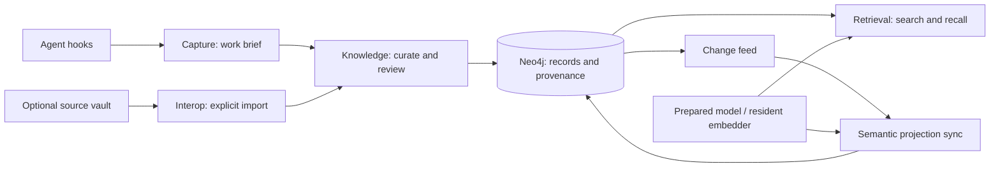

# The Neo4j refactor: architecture and walkthrough

Noesis now keeps its knowledge in Neo4j. Capture collects finished work; curation turns it
into Experiences and proposed Knowledge; review determines which guidance is accepted.
Search finds records, and recall assembles a task briefing with revision citations. An
Obsidian vault is an optional, one-time import source, not the database or a live mirror.
There is no Notes context, Vectra backend, or filesystem fallback for record bodies.

This guide describes the current implementation, including structural links, recall,
consolidation and optional semantic retrieval. Older planning documents contain superseded
proposals; the CLI and source are the authority for the commands below.

## Architecture and ownership

| Component | Owns |
| --- | --- |
| Capture (`bounded_context/capture`) | Agent sessions, hook events, commit/transcript inspection, thresholds, work briefs and capture journal. It publishes briefs to Knowledge curation; it never accepts guidance. |
| Interop (`bounded_context/interop`) | Explicit Markdown imports, normalization, wiki/Markdown link parsing and target resolution. Writes go through Knowledge contracts. |
| Knowledge (`bounded_context/knowledge`) | Spaces, projects, records, immutable revisions, provenance, assertions, review decisions, curation, catalog, LinkSets and consolidation bookkeeping; transactional change-feed production. |
| Retrieval (`bounded_context/retrieval`) | Candidate collection, graph expansion, ranking, semantic projections and their cursors/leases, and recall briefings. It reads Knowledge through contracts. |
| CLI (`interfaces/cli`) | Commands, JSON envelopes, actor/project/runtime resolution and composition roots that wire ports to adapters. |
| Core / shared kernel | Typed configuration, shared JSON-native contracts, common primitives and Neo4j connectivity. Diagnostics checks the running installation. |

Contexts communicate through consumer-owned ports and provider inbound adapters using
`shared_kernel/contracts`; application/domain code does not import another context's internals.



### What is in Neo4j

The six record kinds have `:Record` plus their kind label: `:Knowledge`, `:Experience`,
`:Assertion`, `:Source`, `:Project`, `:CatalogEntry`. `:Space` is the stored label for a
KnowledgeSpace. Each record belongs to one space through `IN_SPACE`; scoped records use
`BELONGS_TO_PROJECT`. IDs are stable ULIDs.

Knowledge text lives on `:Revision` nodes with `REVISION_OF` pointing to the Knowledge
record, which tracks its head. Revisions cite Sources with `FROM_SOURCE`. Experiences keep
immutable text and occurrence/session/environment metadata directly on their nodes, have
Sources, and have no review status. Sources are provenance locators, not instructions to
open those files at recall time.

Assertions are reviewed judgments (`supports`, `contradicts`, `supersedes`, `recommends`):
`SUBJECT` and `OBJECT` identify their endpoints, `EVIDENCED_BY` identifies evidence, and
`FROM_SOURCE` preserves provenance. `:Decision` nodes connect through `DECIDES` and record
review history. Knowledge and assertions progress from `proposed` to `accepted`, and may
become `superseded` or `retracted`. Accepted text is not revised in place: propose a new
record and a `supersedes` assertion. Agents can accept eligible project-scoped guidance;
space-wide acceptance requires a person. Structural links confer no authority.

`(:Knowledge)-[:LINKS_TO|EMBEDS]->(:Knowledge)` stores imported structure with origin,
occurrence counts and anchors. A `:LinkSet` is bookkeeping keyed by `source_record_id`,
versioned separately from text. Replacement swaps that source's outgoing set atomically.
Incoming links remain attached to the original when it is superseded. Dangling or ambiguous
links are counted and skipped; import creates no placeholder records.

`:Consolidation` and `:ConsolidationMembership` are bookkeeping, not searchable records.
Memberships use `OF` and `CONSOLIDATES` (with the judged revision); `PRODUCED` identifies the
successor and assertions. Consolidation preserves originals, revisions and links.

Other operational nodes are `:IdempotencyKey` (retry ledger), `:StoreMeta` (applied schema
steps), `:ChangeCounter` and `:Change` (per-space feed), `:IndexCursor` (projection progress,
profile and lease), and `:Embedding` (semantic chunks and vectors).

`store init` applies these additive, idempotent steps in order, then ensures the configured
space exists. Schema statements commit before their `StoreMeta` marker; rerunning repairs
an interruption between them.

| Step | Constraints / indexes |
| --- | --- |
| `core` | Unique record ID, space ID/key, revision key, project key, source key and idempotency key. |
| `review` | Unique decision key and live assertion statement key. |
| `change_feed` | Unique change key and counter per space. |
| `knowledge_fulltext` | Full-text `knowledge_fulltext` on `Revision` and `Experience` title/body, using the `standard` analyzer. Queries retain Knowledge head revisions. |
| `retrieval_index` | Unique cursor key per projection and space. |
| `retrieval_semantic` | Unique embedding key, `embedding_record` index on `(space_id, record_id)`, and `retrieval_semantic_vector`, a native vector index on `Embedding.vector`: 384 dimensions, cosine. This schema is installed even without the semantic extra. |
| `catalog` | Unique catalog key. |
| `links` | Unique LinkSet source record ID. |
| `consolidation` | Unique consolidation ID, membership key and open membership reservation. |

### Change feed and retrieval

Record writers append `created`, `revised` or `status_changed` changes in the same transaction
as the corresponding write. A per-space counter supplies ordered sequence numbers. Sync
consumes changes after each projection's cursor, with a fenced, renewable lease; retries
must not advance a cursor past an unprocessed failure. LinkSet replacements and consolidation
bookkeeping emit no feed event. Their record/review effects do; graph discovery reads links
live, so link edits do not require re-embedding text. Consumers tolerate non-text changes.

Lexical search is a live Neo4j full-text query, not a separately synchronized local index.
Retrieval resolves current record heads, drops stale candidates by default, applies scope,
tags/type/status filters and excludes retracted records unless requested. It over-fetches and
retries once if filtering leaves too few results; `filter_shortfall` makes that visible.

```text
query -> lexical candidates ----+-> graph neighbours --+
       -> semantic (optional) --+                      +-> fusion -> scope/authority -> hits
                               +----------------------+
recall -> read cited graph revisions -> deterministic digest or Claude briefing
```

Graph seeds come from the leading candidates (lexical only for identifier queries). Neighbours
include shared Sources and incoming/outgoing `LINKS_TO`/`EMBEDS`, with bounded supersession
traversal to separately cited successors. Shared-source candidates rank first by shared-source
count; link-only candidates rank by distinct supporting seeds, then seed rank and record ID.
These are discovery signals, not evidence that the guidance is correct.

Ordinary queries combine lexical, graph and available semantic rankings with equal-weight
reciprocal-rank fusion: each list contributes `1 / (60 + zero_based_position)`. Ties retain
first appearance. Authority then orders accepted Knowledge, Experiences, proposed/unreviewed,
superseded, and explicitly requested retracted records, retaining fused order within tiers.
Identifier-like queries (paths, flags, dotted names, snake_case, camelCase, UUIDs, ticket IDs,
backticks) preserve the lexical+graph baseline and append semantic-only hits. Authority tiers
are applied separately to those two groups: an accepted semantic neighbour cannot displace a
proposed exact-identifier hit.

Semantic retrieval uses `BAAI/bge-small-en-v1.5`, the pinned fp32 ONNX model (384-dimensional
cosine vectors), with quality evaluated for English. Other languages are accepted without a
quality promise. Knowledge title plus body, or Experience body, is split into 448-token
windows with 64-token overlap; a record appears once, ranked by its best chunk. Vectors live
in Neo4j's native index, not in a second database. Model artifacts live in the local cache.
`index model prepare` is the only downloading command; other operations are offline.

In `resident` mode a separately started embedder loads the model once and serves a private
Unix socket. It has no graph connection and no network listener. Search can use it automatically;
recall never loads a model per call. In `per-call` mode search needs `--semantic` or
`--require-semantic`; sync/rebuild load it themselves. In `off` mode semantic is disabled.
A missing semantic runtime normally leaves lexical+graph available; `--require-semantic`
makes absence an error. Store failure always fails closed. A mismatched built profile requires
an explicit rebuild. Search and recall never sync; lagging vectors are reported and can still
be served. Capture requests a detached sync, but the final checklist includes an explicit sync.

Recall reads whole graph-owned bodies within its evidence budget, labels proposals and
superseded guidance, and cites `{record_id, revision}`. `--no-synthesis` returns a deterministic
digest. Otherwise an isolated Claude process synthesizes the evidence; failure is explicit,
not a silent digest fallback. Catalog recommendations require live assertions and observed
runtime availability; catalog registration alone does not prove a tool is installed.

### Filesystem boundaries

For **knowledge content**, the only source-vault reads happen during explicit import, and the
only semantic artifact files are the prepared model cache. Search/recall never reopen source
notes, check vault drift, or write knowledge Markdown. Import never modifies the source vault.

This does **not** mean the application performs no other filesystem I/O: configuration,
capture session state/journals/briefs, the retryable curation inbox, git/transcript inspection,
optional prompt files, runtime inventory/settings, and the embedder socket remain local.
Neo4j itself persists its database in the Compose volume. These operational files are not an
alternative record store. `import file` can explicitly read a file outside a vault as well.

## Configuration reference

Loading order: process environment overrides the selected env file. `--env-file FILE` before
the command overrides repository-profile selection; otherwise a `.noesis-config` profile
selects `~/.config/noesis/profiles/<repo>/<name>.env`, falling back to the user config env file.
XDG config paths apply. Unknown file keys are ignored. Keep the database password in the
process environment or a user-side profile, never in a committed repository file.

These are all current application `.env` keys from `core/configurations`, including
`NOESIS_IMPORT_VAULT_KEY`, which is not listed in `.env.example`. “Unset” means omit the key,
not an empty numeric/path assignment. Defaults below are code defaults; the example file
explicitly sets `NOESIS_VAULT_DIR=~/brain`, whereas the code default is unset.

| Variable | Default | Meaning |
| --- | --- | --- |
| `NOESIS_VAULT_DIR` | unset | Read-only source folder for `import run`; not needed otherwise. |
| `NOESIS_IMPORT_VAULT_KEY` | vault folder name | Locator namespace in `vault://<key>/<path>`; letters, digits, `.`, `_`, `-`. |
| `NOESIS_STATE_DIR` | `$XDG_STATE_HOME/noesis`, else `~/.local/state/noesis` | Capture state/logs and curation inbox. |
| `NOESIS_LOG_LEVEL` | `INFO` | `DEBUG`, `INFO`, `WARNING`, `ERROR`. |
| `NOESIS_CAPTURE_MIN_FILES` | `2` | Significant-change file threshold (nonnegative). |
| `NOESIS_CAPTURE_MIN_LINES` | `20` | Significant-change line threshold (nonnegative); either threshold suffices. |
| `NOESIS_CAPTURE_DEBOUNCE_SECONDS` | `300` | Minimum interval between handovers (nonnegative). |
| `NOESIS_CAPTURE_TRACE` | `false` | Journal even silent hook calls. |
| `NOESIS_CURATOR_CLAUDE_BIN` | `claude` | Curator executable. |
| `NOESIS_CURATOR_MODEL` | empty | Claude model alias/ID; empty uses its default. |
| `NOESIS_CURATOR_MAX_BUDGET_USD` | `0.5` | Positive budget per curator run. |
| `NOESIS_CURATOR_TIMEOUT_SECONDS` | `300` | Positive run timeout. |
| `NOESIS_CURATOR_RETRY_SECONDS` | `30` | Nonnegative delay before automatic retry. |
| `NOESIS_CURATOR_RELATED_LOOKUP` | `required` | `required` parks when related lookup fails; `off` disables lookup. |
| `NOESIS_CURATOR_SYSTEM_PROMPT_FILE` | unset | Custom Markdown system prompt; otherwise packaged prompt. |
| `NOESIS_NEO4J_URI` | `bolt://127.0.0.1:7687` | Neo4j connection URI. |
| `NOESIS_NEO4J_USER` | `neo4j` | Database user. |
| `NOESIS_NEO4J_PASSWORD` | unset | Required secret for store operations. |
| `NOESIS_NEO4J_DATABASE` | `neo4j` | Database name. |
| `NOESIS_NEO4J_CONNECT_TIMEOUT_SECONDS` | `5` | Positive connection timeout; unreachable store fails closed. |
| `NOESIS_KNOWLEDGE_SPACE` | `personal` | Active space key; letters, digits, `.`, `_`, `-`. |
| `NOESIS_INDEX_LOCK_TTL_SECONDS` | `300` | Positive sync/rebuild lease duration, renewed during work. |
| `NOESIS_RETRIEVAL_BRIEFING_CLAUDE_BIN` | `claude` | Recall synthesis executable. |
| `NOESIS_RETRIEVAL_BRIEFING_TIMEOUT_SECONDS` | `60` | Positive synthesis timeout. |
| `NOESIS_RETRIEVAL_BRIEFING_MAX_BUDGET_USD` | `0.50` | Positive synthesis budget. |
| `NOESIS_RETRIEVAL_BRIEFING_MAX_EVIDENCE_CHARS` | `24000` | Positive combined redacted title/body evidence budget. |
| `NOESIS_RETRIEVAL_SEMANTIC_MODE` | `resident` | `resident`, `per-call`, or `off`. |
| `NOESIS_RETRIEVAL_MODEL_CACHE_DIR` | `$XDG_CACHE_HOME/noesis/models`, else `~/.cache/noesis/models` | Verified model artifacts. |
| `NOESIS_RETRIEVAL_RUNTIME_DIR` | absolute `$XDG_RUNTIME_DIR`, else unset | Socket root; when unset, a private directory under the model cache is used. |
| `NOESIS_RETRIEVAL_EMBEDDER_THREADS` | unset | Positive ONNX intra-op thread count; unset lets runtime choose. |

The following are **process-environment inputs**, not noesis `.env` settings:

| Variable | Default / purpose |
| --- | --- |
| `XDG_CONFIG_HOME` | `~/.config`; configuration root. |
| `XDG_STATE_HOME` | `~/.local/state`; state root. |
| `XDG_CACHE_HOME` | `~/.cache`; cache root. |
| `XDG_RUNTIME_DIR` | Unset; runtime root. XDG values must be absolute or the fallback is used. |
| `CLAUDE_CONFIG_DIR` | `~/.claude`; Claude settings/inventory. |
| `CODEX_HOME` | `~/.codex`; Codex configuration/plugin inventory. |
| `NOESIS_SESSION_ID` | Unset; explicit session identity for an otherwise unknown harness. |
| `CODEX_THREAD_ID`, `CODEX_SESSION_ID` | Unset; Codex session identity. |
| `CLAUDECODE`, `CLAUDE_CODE_SESSION_ID`, `AI_AGENT` | Unset; harness identity/markers. Any nonempty harness marker causes agent actor resolution. |

## End-to-end checklist

Run from this checkout with Python 3.14+ and `uv`; Docker is needed for the local store.
Commands use `uv run noesis` so they run this checkout. An installed CLI can omit `uv run`.
Use a normal interactive user terminal for review decisions; do not spoof harness markers.
Replace quoted ID placeholders with IDs printed by preceding commands. Examples use project
`walkthrough`, so explicit project selection avoids the current directory changing scope.

These commands write to the configured database. Choose a fresh instance/space for sample
content. This guide's commands were checked with `--help` and source inspection, not executed
against a personal store.

### 1. Start the store and install the CLI

Supply your own password of at least eight characters in the shell (do not commit it):

```sh
export NOESIS_NEO4J_PASSWORD='replace-with-your-local-secret'
export NOESIS_NEO4J_URI='bolt://127.0.0.1:7687'
export NOESIS_NEO4J_USER='neo4j'
export NOESIS_NEO4J_DATABASE='neo4j'
export NOESIS_KNOWLEDGE_SPACE='walkthrough'
docker compose up -d
uv sync
```

Expect Neo4j `5.26.33-community`, HTTP on loopback port 7474 and Bolt on 7687, with data in
`neo4j-data`. Wait for startup before initialization. Compose reads the password from its
shell environment, not noesis's user config file. `NEO4J_AUTH` in Compose sets the initial
password only on an empty volume; changing the shell variable does
not change an existing database password. `uv sync` installs the base CLI without the
optional semantic dependencies; step 5 adds those if desired.

### 2. Initialize the schema and space

```sh
uv run noesis store init --json
```

Expect `applied_steps` and `default_space` with key `walkthrough`. Repeating is safe and
reports `already_applied_steps`; rerun after upgrades to install new schema steps.

### 3. Optionally import a vault and inspect its edges

Point to a source folder you choose, preview, then apply:

```sh
export NOESIS_VAULT_DIR='/absolute/path/to/source-vault'
export NOESIS_IMPORT_VAULT_KEY='walkthrough-vault'
uv run noesis import run --verbose --json
uv run noesis import run --yes --verbose --json
```

Expect `proposed` Knowledge tagged `origin:migrated`, `vault://` Sources, per-note outcomes,
`links` counts and `link_sets` outcomes. Wiki links, embeds and relative Markdown note links
become edges when targets resolve; code and external URLs do not. Ambiguous/dangling targets
are reported, not invented. Repeating an unchanged import is safe. An intentional later
refresh uses `uv run noesis import run --yes --update --verbose --json`: proposed text gets a
revision, while changed accepted text gets a proposed successor and `supersedes` assertion.
This is an explicit re-import, not continuous synchronization.

In Neo4j Browser at `http://127.0.0.1:7474`, sign in with the configured credentials and run
this read-only query (substitute your space key if different):

```cypher
MATCH (s:Space {key: 'walkthrough'})<-[:IN_SPACE]-(a:Knowledge)
MATCH (a)-[r:LINKS_TO|EMBEDS]->(b:Knowledge)
RETURN a.id, type(r), b.id, properties(r)
LIMIT 25;
```

Expect edges with `origin: migrated`, counts and anchors if the imported notes had resolvable
links. An empty result is valid for a vault without such links. For one file instead:

```sh
uv run noesis import file /absolute/path/to/note.md --project walkthrough --dry-run
uv run noesis import file /absolute/path/to/note.md --project walkthrough
```

That path uses `origin:imported` and does not import links. Vault acceptance is optional and
requires reviewing what the import proposed; the bulk form is shown in step 8.

### 4. Seed a record and search lexically

This also makes the walkthrough work when import was skipped:

```sh
uv run noesis record capture --type knowledge --subtype convention \
  --title 'Walkthrough retry policy' \
  --body 'Retry transient network failures with bounded exponential backoff.' \
  --project walkthrough --source 'agent_session:walkthrough-demo' \
  --idempotency-key walkthrough-seed-v1 --json
NOESIS_RETRIEVAL_SEMANTIC_MODE=off uv run noesis search 'retry' --project walkthrough --json
```

Expect a proposed Knowledge ID and then a lexical hit for it (graph neighbours may also
appear). Save that ID as `SEED_ID` for step 8. The `sources` on search hits describe discovery
channels such as `lexical`/`graph`, not the underlying provenance Source records. The
environment assignment disables semantic only for this one command. No index sync is needed
for lexical search. Use `--all-projects` instead of `--project` to search the entire space.

### 5. Optionally prepare semantic search

```sh
uv sync --extra semantic
export NOESIS_RETRIEVAL_SEMANTIC_MODE=resident
uv run noesis store init
uv run noesis index model prepare
uv run noesis index embedder serve
```

Expect a verified model download (about 133 MB) and then a foreground embedder process. Leave
it running; nothing auto-starts it. In another terminal with the same configuration and
space, from the same checkout:

```sh
uv run noesis index rebuild --yes
uv run noesis index status --verify --json
uv run noesis search 'recover safely from temporary connection failures' \
  --project walkthrough --semantic --require-semantic --json
```

Expect a completed semantic projection, zero lag once caught up, no verification divergences,
and semantic state `ready`. Semantic matches are candidates, not guaranteed hits for every
query. A failure with `--require-semantic` is useful here: it prevents a silent lexical-only
demonstration. `--semantic` is also the explicit model-load opt-in for `per-call` mode; that
mode needs no serving terminal but pays model startup cost per invocation. Skip this entire
step for a lexical+graph-only installation.

### 6. Capture new work

For actual Claude Code sessions, preview/install hooks, then enable capture with the real
session ID supplied by that session (replace `SESSION_ID`):

```sh
uv run noesis integrate claude-code install
uv run noesis integrate claude-code install --yes
uv run noesis capture on --session SESSION_ID --mode live
uv run noesis capture status --session SESSION_ID
```

Do and commit a meaningful unit of work in that session, then inspect:

```sh
uv run noesis capture runs --session SESSION_ID --json
```

Expect capture journal/results and a work brief when the capture trigger/thresholds are met;
live capture launches curation asynchronously. Merely running `capture on` does not fabricate
a brief. This hook integration edits Claude's settings with a backup. For a deterministic
manual walkthrough without an agent session, continue with the supplied example in step 7.

### 7. Curate a brief or apply explicit candidates

The brief route requires an authenticated Claude CLI and may legitimately produce no guidance:

```sh
uv run noesis curate brief --brief-file docs/examples/work-brief.json --dry-run --json
uv run noesis curate brief --brief-file docs/examples/work-brief.json --json
```

The supplied file is fictional demo work in project `demo`; copy and edit it to describe real
work before using this workflow outside the walkthrough. A dry run invokes the curator but
writes/parks nothing. Applying stages the redacted brief, persists a plan, and returns per-item
outcomes; replaying the same submission does not duplicate records. Automatic capture already
performs this handover, so you need not manually ingest its brief a second time.

To continue reproducibly without a curator, apply these fictional walkthrough candidates from
stdin, citing a synthetic demo session:

```sh
uv run noesis curate apply \
  --session walkthrough-demo --decisions-file - --json <<'JSON'
{"candidates":[
  {"kind":"experience","key":"retry-test","subtype":"outcome",
   "body":"Walkthrough simulation: bounded retries recovered from a transient timeout."},
  {"kind":"knowledge","key":"retry-rule","subtype":"convention",
   "title":"Walkthrough retry bounds",
   "body":"Retry transient network failures with exponential backoff and a finite attempt limit.",
   "evidence_keys":["retry-test"],
   "reason":"The simulated outcome illustrates why transient retries need bounds."}
]}
JSON
```

Expect an Experience, proposed Knowledge, and a proposed `supports` assertion. Save the
Knowledge `record_id` as `RULE_ID` and its support assertion ID as `SUPPORT_ID` from `items`.
Apply uses the current git repository as project scope, so **for subsequent commands replace
`RULE_PROJECT` with that repository name** (in this checkout, `noesis`). The seed remains in
`walkthrough`; step 10 provides a second same-project record for consolidation. This distinction
is necessary because `curate apply` has no `--project` flag.

### 8. Review Knowledge and assertions

Read the records and their proposal queue before applying decisions:

```sh
uv run noesis record get RULE_ID --json
uv run noesis review queue --project RULE_PROJECT --json
uv run noesis assertion list --about RULE_ID --json
uv run noesis review accept RULE_ID --expected-revision 1
uv run noesis review accept RULE_ID --expected-revision 1 --yes \
  --idempotency-key walkthrough-rule-accept-v1
uv run noesis review accept SUPPORT_ID
uv run noesis review accept SUPPORT_ID --yes --idempotency-key walkthrough-support-accept-v1
uv run noesis review log SUPPORT_ID --json
```

Use the current revision returned by `record get` if it differs from 1. Expect previews without
`--yes`, accepted status after application, and decision history. Experiences themselves have
no acceptance step. Evidence must be independent of assertion endpoints for agent acceptance;
a shared Source or structural edge is not an endorsement. A person applies user decisions in
an interactive terminal; agents cannot accept space-wide guidance.

Optionally accept the seed after reading it:

```sh
uv run noesis record get SEED_ID
uv run noesis review accept SEED_ID --expected-revision 1 --yes \
  --idempotency-key walkthrough-seed-accept-v1
```

For migrated Knowledge, a person can preview and then bulk accept the tag after inspecting it:

```sh
uv run noesis review accept --tag origin:migrated --all
uv run noesis review accept --tag origin:migrated --all --yes
```

That accepts proposed Knowledge with the tag, not every assertion. No import, capture, recall
or consolidation command runs bulk acceptance for you.

### 9. Recall a memory briefing

```sh
uv run noesis recall 'implement bounded retries for network requests' \
  --project RULE_PROJECT --no-synthesis --json
uv run noesis recall 'implement bounded retries for network requests' --project RULE_PROJECT
```

Expect a deterministic digest with exact record/revision citations from the first command.
The second uses Claude synthesis and needs authentication; evidence can include accepted
constraints/decisions, context, explicitly unconfirmed proposals and runtime tool observations.
An empty evidence set is a successful `no_evidence` result. Semantic is optional; resident mode
can contribute candidates, but recall never starts an embedder or loads a per-call model.

### 10. Scan, propose and accept consolidation

Create a second same-project, same-subtype candidate to make the example reproducible:

```sh
uv run noesis record capture --type knowledge --subtype convention \
  --title 'Walkthrough transient retry limit' \
  --body 'Bound network retries with a finite attempt limit and exponential backoff.' \
  --project RULE_PROJECT --source 'agent_session:walkthrough-demo' \
  --idempotency-key walkthrough-second-rule-v1 --json
```

Save its ID as `SECOND_ID`, read it, and accept it:

```sh
uv run noesis record get SECOND_ID
uv run noesis review accept SECOND_ID --expected-revision 1 --yes \
  --idempotency-key walkthrough-second-rule-accept-v1
uv run noesis consolidation scan --project RULE_PROJECT --json
uv run noesis consolidation propose --member RULE_ID --member SECOND_ID \
  --title 'Walkthrough bounded network retry policy' \
  --body 'Retry transient network failures using exponential backoff and a finite attempt limit.' \
  --rationale 'Both accepted conventions express the same bounded retry rule.' \
  --idempotency-key walkthrough-consolidation-v1 --json
```

Scan is read-only; ranks suggest overlap, not equivalence. Members must be 2–10 accepted,
non-superseded Knowledge records in the same project and subtype. Proposed imported records
are excluded. Inspect the result's successor/assertion IDs and save `consolidation_id` as
`CONSOLIDATION_ID`:

```sh
uv run noesis consolidation show CONSOLIDATION_ID --json
uv run noesis consolidation accept CONSOLIDATION_ID
uv run noesis consolidation accept CONSOLIDATION_ID --yes \
  --idempotency-key walkthrough-consolidation-accept-v1 --json
uv run noesis recall 'bounded network retries' --project RULE_PROJECT --no-synthesis --json
```

Expect successor acceptance followed by each `supersedes` acceptance; originals become
superseded without being deleted or having their links rewritten. Recall can cite the successor
separately. Partial failures retain completed steps: retry the same acceptance command and
idempotency key to resume. Recommendations/supports are not transferred to the successor.

### 11. Sync and check the installation

```sh
uv run noesis index sync --wait-seconds 30 --json
uv run noesis index status --verify --json
uv run noesis doctor --json
uv run noesis curate parked --json
```

With semantic enabled and the embedder running, expect the cursor to catch up to the feed
head, zero lag and no divergences. Without the extra (or with semantic mode `off`), index
commands validly return `projections: []` plus a warning: lexical and graph search still work.
Doctor reports configuration, state-directory/executable and store-related checks; inspect
individual findings rather than treating its output as an indexing test. Parked curations
should be empty unless a preceding run failed. For real failures, fix the cause and run:

```sh
uv run noesis curate retry TICKET --json
```

The ticket is from `curate parked`; retry resumes the saved stage/plan. When finished capturing
an actual session, turn it off with `uv run noesis capture off --session SESSION_ID`.

## Troubleshooting and next reading

| Symptom | Check / next action |
| --- | --- |
| Missing password, auth failure, or `INTEGRATION_103_GRAPH_STORE_UNAVAILABLE` | Check the selected profile, shell overrides, URI/ports, database credentials and container startup. Noesis will not fall back to vault text. See [store setup](../workflows/store.md). |
| Missing schema step or space | Run `uv run noesis store init` against the intended connection/space. |
| Empty search results | Check `scope` and warnings in JSON; an unknown project searches space-wide records only. Try `--all-projects`, then inspect status/tag filters. See [search](../commands/search.md). |
| Semantic absent/unavailable | `uv run noesis index status --json` reports extra, model, runtime and vector-index state without downloading/loading anything. Install the extra, prepare the model, start the resident process and rebuild as indicated. |
| `RETRIEVAL_202_INDEX_REBUILD_REQUIRED` or interrupted rebuild | Run `uv run noesis index rebuild --yes` in the affected space. Ordinary sync cannot finish an interrupted rebuild. |
| `RETRIEVAL_203_INDEX_SYNC_IN_PROGRESS` | Another holder may be active or the lease was lost; allow it to finish and retry sync. A crashed holder's lease expires. See [index](../commands/index.md). |
| Curation parked / invalid candidate payload | Inspect `curate parked --json` and the error's ticket/cause; fix authentication, lookup or payload, then retry. State is under `NOESIS_STATE_DIR/knowledge/curation`. See [curate](../commands/curate.md). |
| Recall synthesis failure | Check Claude authentication/executable/budget; explicitly use `--no-synthesis` for the deterministic digest. See [recall](../commands/recall.md). |
| Review denied / revision conflict | Read `record get` and `review queue` again. Use the revision actually reviewed; use a person for space-wide or bulk acceptance. `review accept --help` and `assertion propose --help` describe the current flags. |
| Supersession effect interrupted | Preview `uv run noesis review repair`; apply pending effects with `uv run noesis review repair --yes` under the normal actor rules. |
| Import has blocked notes or missing links | Inspect `--verbose --json`; aliases are not lookup keys, and unresolved/non-note/self targets are skipped. `--strict` blocks on note findings before writing, not on link classifications. See [import](../commands/import.md). |
| Consolidation partially applied | Inspect `consolidation show` and retry with the same key/payload; do not assume rollback. See [consolidation](../commands/consolidation.md). |

Further references: [command index](../commands/README.md), [capture](../commands/capture.md),
[record/store](../commands/record.md), [catalog](../commands/catalog.md),
[configuration/setup](../commands/setup.md), [architecture](../architecture.md), and
[workflow index](../workflows/README.md). Review/assertion commands currently have no separate
command-reference Markdown page; use their `--help` and the [record-store ADR](../adr/0003-knowledge-context-and-neo4j-record-store.md).
