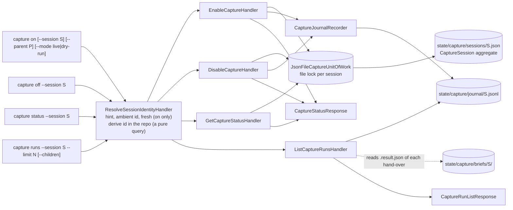

# `capture on | off | status | runs`

`off` keeps pending commits; `on` again resumes with them.

## Session identity

The stored id is `<repo id>-<12 hex>`, where the repo id is `<main folder name>-<8 hex of the
common git directory>` (so every worktree of a repository shares it). The id you pass (`--session`, or the id in a Claude Code hook payload), the
agent's own (Codex: `CODEX_THREAD_ID`, then `CODEX_SESSION_ID`; then `NOESIS_SESSION_ID`) or a fresh one is hashed with the repo id; an id that already
has that shape passes through, so the printed `result.session_id` can be passed back. `repos.json`
in `<state>/capture/` records which folder each repo id stands for (write-only, never read to
decide anything).

- `capture on` twice is a no-op (quiet `already_enabled` in trace mode): pending commits, cursor
  and mode are kept. `--mode` is optional and only changes the mode when given.
- `capture on --parent P` creates a child session: its own file, pending commits and cursor,
  the parent's mode, and a `parent_id`. The parent is read and released before the child is
  written (one session per transaction). `capture runs --children` merges the journals of the
  descendants (cycle-safe, depth-capped). Each session file has its own `flock`, and the journal
  is append-only and unlocked, so a parent and its children never block each other.
- Upgrading: sessions switched on by an older noesis live under the old ids. There is no
  migration; run `capture on` again.

Back to [workflows](README.md).
