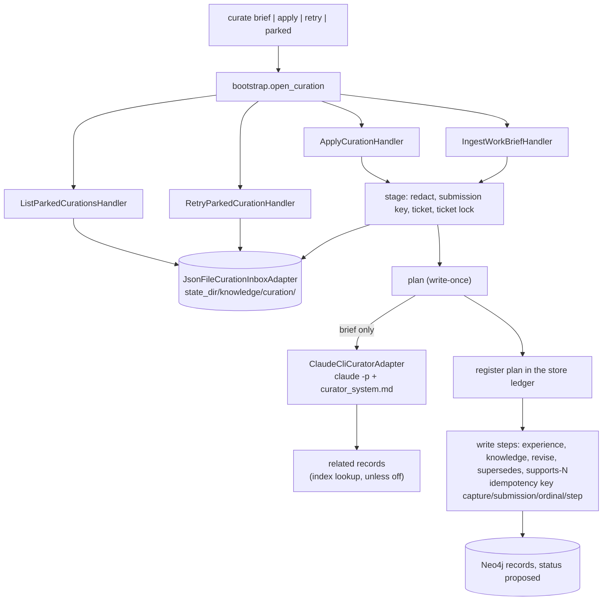

# `curate brief | apply | retry | parked`

Curation lives in the Knowledge context. A submission (a work brief, or candidates you wrote) is
staged in a local inbox, planned once, and then written to the store step by step, so a failure
at any stage can be retried without judging or writing twice.

- **Ordinals** number the candidates of the plan from 1 and never shift: a skipped candidate
  keeps its position. Each write uses the idempotency key `capture/<submission_key>/<ordinal>/<step>`,
  so a retry returns the ids already written.
- **Capture never accepts.** Every record written is a proposal; review is a separate, human
  step (`noesis review ...`).
- **Failure** parks the ticket with the stage it failed at (`KNOWLEDGE_241`); `curate retry`
  resumes from that stage. A saved plan is never judged again.
- **Lock.** One lock per ticket; a second process waits at most 10 seconds, then
  `KNOWLEDGE_142`. After the first finishes, the second replays.
- **Secrets** are redacted before anything is staged or sent to the curator.
- **Related lookup** (`NOESIS_CURATOR_RELATED_LOOKUP`): `required` fails closed with
  `KNOWLEDGE_245` and parks the brief; `off` skips it.
- **Detached runs.** Capture's publisher spawns `noesis curate brief --brief-file F`; the
  result lands in `<state dir>/capture/briefs/<session>/*.result.json`, read by
  `noesis capture runs`.
- The Notes state of older versions (`<state dir>/notes/parked`, `apply-failed`) is not
  migrated: drain it with the old version before upgrading.

Options and the result shape: [curate command reference](../commands/curate.md). Back to
[workflows](README.md).
