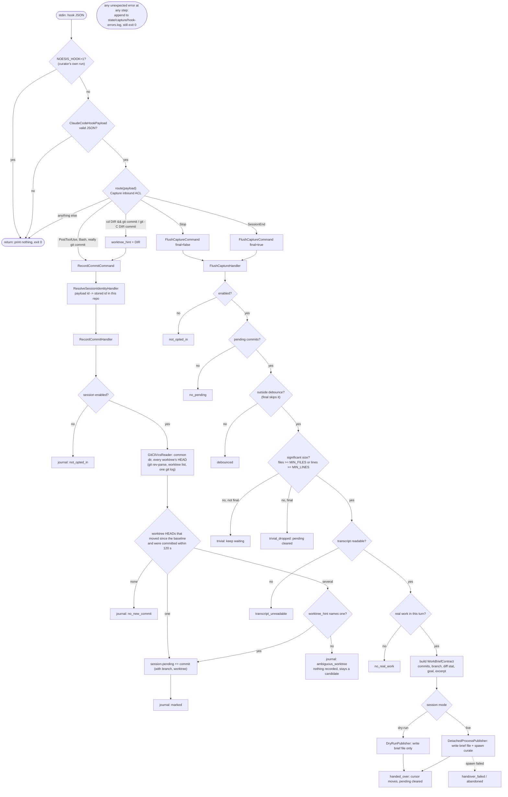

# `hook claude-code` (run by Claude Code, never by hand)

Every outcome (`k1`..`k7`, `ok`, `fail`) is a journal line, which is what `capture runs` shows.

Cost: each commit hook runs a few git calls (`rev-parse --git-common-dir`, `worktree list
--porcelain`, one `git log` over the HEADs, then the commit's own `rev-parse`/`log`/`show`),
about ten milliseconds in total. The hook compares worktree HEADs with the baseline stored in
the session (`observed_heads`), so it finds the commit wherever it was made; the command text is
only a tiebreaker. A flush takes the repository name, path and branch from the recorded commits.

Back to [workflows](README.md).
