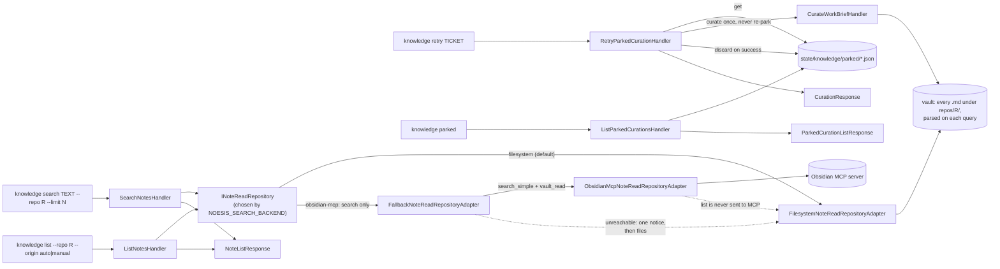

# `knowledge retry | parked | search | list`

## Search backend

`NOESIS_SEARCH_BACKEND` picks who answers `search` (default `filesystem`: no MCP call, no
network). With `obsidian-mcp`:

- `search` calls the MCP tool `search_simple`, keeps the hits under `--repo`/`--area`
  (a folder prefix filter, so both backends return only `repos/R/` for `--repo R`), ranks by
  Obsidian's score, and reads each of the best `--limit` hits with `vault_read` to build the
  same `NoteSummaryDto` as the filesystem adapter. Notes outside the noesis layout (e.g.
  `learning/<topic>/`) are found too, with `kind: null` and `origin: manual`.
- The `--json` result of `search` always carries `backend` (`filesystem` or `obsidian-mcp`): the
  repository that actually produced the notes, so it reads `filesystem` after a fallback even
  with `obsidian-mcp` configured. Text mode prints a trailing `backend: ...` line.
- `list` always reads files: one MCP round trip per note would be chattier than a scan, and
  files give a complete, ordered listing even when Obsidian is closed.
- Unreachable server, rejected token, timeout or an unreadable answer (all `ObsidianMcpError`):
  the files are searched instead, exit code stays `0`, and the message
  `Obsidian MCP unreachable, searched files instead` appears once, as a `notice` field in the
  `--json` result (only then) or a trailing `notice:` line in text mode. After the first failure
  the process does not try Obsidian again, so the timeout is paid once.
- Writes (curation) never go through MCP: `IKnowledgeUnitOfWork` stays on files.

### Does `curate` use the MCP search?

Yes. `CurateWorkBriefHandler` shares the read repository with `knowledge search`, so with
`obsidian-mcp` the curator's related notes (`RELATED_NOTES_LIMIT = 8`) come from Obsidian's
index, which also covers manual notes and know-how folders. It is wrapped in the same
fallback, so curation never fails because Obsidian is closed (the curator runs detached from
hooks, where Obsidian is often not running); the notice goes to stderr, keeping `--json`
output on stdout intact. The manual-wins rule is untouched: the existing auto and manual
note lookups (`uow.notes.get`) still read the files.

Back to [workflows](README.md).
