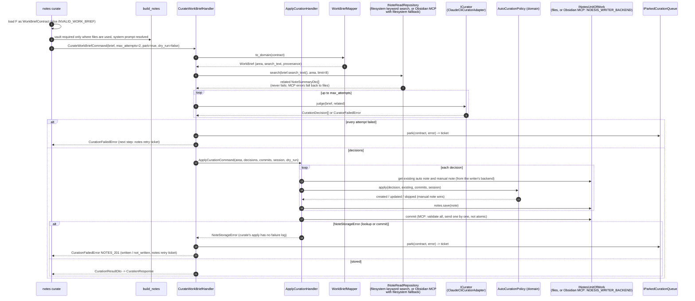

# `notes curate --brief-file F`

With `--dry-run` the curator still runs, but `ApplyCurationHandler` skips `save` and `commit`,
nothing is parked on any failure (no ticket), and the output carries `"dry_run": true`.
Storing is shared with [`notes apply`](notes-apply.md); the only difference is who wrote the
decisions.

Back to [workflows](README.md).
