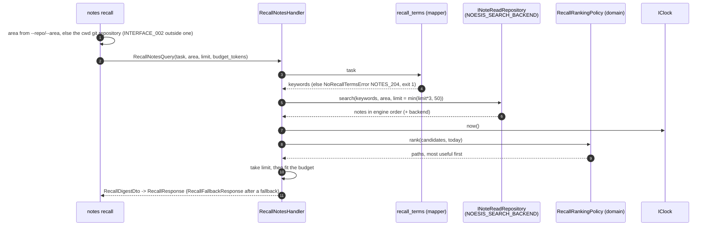

# `notes recall TASK`

Gives an agent (or a person) a short digest of the notes worth reading before a task. It is a
read-only query: it reuses the search behind [`notes search`](notes.md), re-ranks the hits and
trims them to a size budget. It never returns a note body and never writes.

## What the ranking does

The engine only gives an order, so relevance is its rank position. The policy multiplies it by
three weights and sorts the over-fetched hits (three times `--limit`, at most 50):

| Signal | Effect |
|---|---|
| Kind | gotcha = decision > glossary > run; a note with no kind is neutral |
| Recency | halves every 90 days of `updated`, never below a floor; an unknown date gets the floor |
| Origin | manual outranks auto |

Ties break by engine rank, then path. A note is only down-weighted, never dropped: an old run
can still appear when nothing better matched.

## Bounds

- `--limit` (1..20, default 5): most entries.
- `--budget-tokens` (default 1000, `0` is unlimited): rough size cap, 4 characters per token,
  counted over kind, title, path, date and snippet. When the digest is over budget the
  lowest-ranked entries are dropped first, then the remaining snippets are shortened (the best
  entry keeps the most text). A budget smaller than one entry gives zero entries.
- The result reports `considered` (hits ranked) and `omitted` (hits not in `entries`).

## Output and exit codes

`--json` result: `entries` (`kind`, `title`, `path`, `date`, `snippet`), `considered`,
`omitted`, `backend`, and `notice` only after a fallback. Text mode prints one line per entry and
ends with `considered N, omitted M` and `backend: ...`.

| Situation | Result |
|---|---|
| no matches | exit 0, `entries` empty, text `no relevant notes` |
| no keywords left in the task | `NOTES_204_NO_RECALL_TERMS`, exit 1 |
| blank task, `--limit` or `--budget-tokens` out of range | usage error, exit 2 |
| vault not configured | `CORE_002_VAULT_NOT_CONFIGURED`, exit 1 |
| no `--repo`/`--area` outside a git repository | `INTERFACE_002_NOT_IN_GIT_REPOSITORY` (same as `notes apply`) |
| Obsidian unreachable, vault set | files searched, exit 0, `Obsidian MCP unreachable, searched files instead` as `notice` |

Back to [workflows](README.md).
