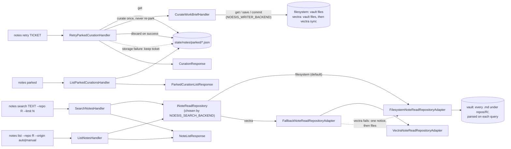

# `notes retry | parked | search | list`

To prepare for a task from the notes, see [`notes recall`](notes-recall.md): it searches by
keyword, reads the best notes and has an agent write a grounded briefing (`--no-synthesis` for the
ranked list only).

## Search backend

`NOESIS_SEARCH_BACKEND` picks who answers `search`: `filesystem` (default: scans the Markdown
files, no network) or `vectra` (semantic search in a vectra collection, falling back to the
files). The removed value `obsidian-mcp` fails at settings validation with
`CORE_006_REMOVED_BACKEND` and a next step that names `filesystem`.

- `search` keeps the hits under `--repo`/`--scope` (a folder prefix filter, so `--repo R` returns
  only `repos/R/`).
- The `--json` result of `search` always carries `backend` (`filesystem` or `vectra`): the
  repository that actually produced the notes, so it reads `filesystem` after a fallback even
  with `vectra` configured. Text mode prints a trailing `backend: ...` line.
- `list` always reads files.
- When vectra fails, the files are searched instead, the exit code stays `0`, and the message
  `vectra could not search, searched files instead` appears once, as a `notice` field in the
  `--json` result (only then) or a trailing `notice:` line in text mode. After the first failure
  the process does not try vectra again.
- Writes (curation) follow `NOESIS_WRITER_BACKEND`, not the search backend; see
  [Writer backend](#writer-backend).

### Does `curate` use the search backend?

Yes. `CurateWorkBriefHandler` shares the read repository with `notes search`, so the curator's
related notes (`RELATED_NOTES_LIMIT = 8`) come from the configured search backend, wrapped in
the same fallback; the notice goes to stderr, keeping `--json` output on stdout intact. The
manual-wins rule is untouched: the existing auto and manual note lookups (`uow.notes.get`) read
from the configured writer's backend, independent of the search backend.

## Writer backend

`NOESIS_WRITER_BACKEND` picks where `curate` and `retry` store notes.

- `filesystem` (default): Markdown files under `NOESIS_VAULT_DIR`; no network call. **NFS** is this
  backend with `NOESIS_VAULT_DIR` pointed at the mount; there is no separate NFS backend.
- `vectra`: the same files, then `vectra sync` into `NOESIS_VECTRA_COLLECTION`; a failed sync keeps
  the files and prints a notice.

The removed value `mcp` fails at settings validation with `CORE_006_REMOVED_BACKEND` and a next
step that names `filesystem`.

**Read/write split.** The writer's backend answers the existing-note lookups (manual notes
win on every backend). Search, `list` and the curator's related notes follow
`NOESIS_SEARCH_BACKEND`.

**Partial failure.** Files are written one at a time and `commit` is not atomic across them: if a
write fails midway, the `NoteStorageError` metadata lists `written` and `not_written` paths ("not
written" means "not confirmed"). The brief is parked and `notes retry <ticket>` overwrites every
note; it re-runs the curator, so it is idempotent per path, not byte-identical.

**Parking.** Any storage failure during `curate` (lookup or commit, any backend) parks the
brief like a curator failure: `NOTES_201`, exit 1, the ticket, the `written` / `not_written`
metadata when present, and the next step `noesis notes retry <ticket>`. With `--no-park` the
`NoteStorageError` (`NOTES_102`) propagates. `retry` keeps the ticket when storage fails
again. A failure of the related-notes search is not a storage failure.

**Vault requirement.** Every remaining backend uses the vault folder, so a missing
`NOESIS_VAULT_DIR` fails with `CORE_002` before the curator runs.

**Doctor.** The `writer` check reports the filesystem writer (writability is the `vault` check)
and makes no write.

Back to [workflows](README.md).
