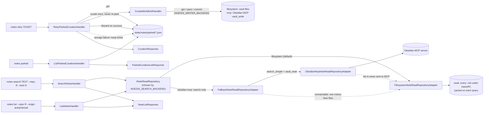

# `notes retry | parked | search | list`

To prepare for a task from the notes, see [`notes recall`](notes-recall.md): it searches by
keyword, reads the best notes and has an agent write a grounded briefing (`--no-synthesis` for the
ranked list only).

## Search backend

`NOESIS_SEARCH_BACKEND` picks who answers `search` (default `filesystem`: no MCP call, no
network). With `obsidian-mcp`:

- `search` calls the MCP tool `search_simple`, keeps the hits under `--repo`/`--scope`
  (a folder prefix filter, so both backends return only `repos/R/` for `--repo R`), ranks by
  Obsidian's score, and reads each of the best `--limit` hits with `vault_read` to build the
  same `NoteSummaryDto` as the filesystem adapter. Notes outside the noesis layout (e.g.
  `learning/<topic>/`) are found too, with `kind: null` and `origin: manual`.
- The `--json` result of `search` always carries `backend` (`filesystem` or `obsidian-mcp`): the
  repository that actually produced the notes, so it reads `filesystem` after a fallback even
  with `obsidian-mcp` configured. Text mode prints a trailing `backend: ...` line.
- `list` always reads files: one MCP round trip per note would be chattier than a scan, and
  files give a complete, ordered listing even when Obsidian is closed.
- Unreachable server, rejected token, timeout or an unreadable answer (all `ObsidianMcpError`):
  the files are searched instead, exit code stays `0`, and the message
  `Obsidian MCP unreachable, searched files instead` appears once, as a `notice` field in the
  `--json` result (only then) or a trailing `notice:` line in text mode. After the first failure
  the process does not try Obsidian again, so the timeout is paid once.
- Writes (curation) follow `NOESIS_WRITER_BACKEND`, not the search backend; see
  [Writer backend](#writer-backend).

### Does `curate` use the MCP search?

Yes. `CurateWorkBriefHandler` shares the read repository with `notes search`, so with
`obsidian-mcp` the curator's related notes (`RELATED_NOTES_LIMIT = 8`) come from Obsidian's
index, which also covers manual notes and know-how folders. It is wrapped in the same
fallback, so curation never fails because Obsidian is closed (the curator runs detached from
hooks, where Obsidian is often not running); the notice goes to stderr, keeping `--json`
output on stdout intact. The manual-wins rule is untouched: the existing auto and manual
note lookups (`uow.notes.get`) read from the configured writer's backend (files by default,
`vault_read` with `NOESIS_WRITER_BACKEND=mcp`), independent of the search backend.

## Writer backend

`NOESIS_WRITER_BACKEND` picks where `curate` and `retry` store notes.

- `filesystem` (default): Markdown files under `NOESIS_VAULT_DIR`; no MCP call. **NFS** is this
  backend with `NOESIS_VAULT_DIR` pointed at the mount; there is no separate NFS backend.
- `mcp`: notes are stored through Obsidian's MCP server with `vault_write`, at the same relative
  paths and with byte-identical Markdown (one shared `NoteMapper`). It uses
  `NOESIS_OBSIDIAN_MCP_URL`, `NOESIS_OBSIDIAN_MCP_TOKEN` (secret, never logged) and
  `NOESIS_OBSIDIAN_MCP_TIMEOUT_SECONDS`, the same server as the `obsidian-mcp` search.

**Read/write split.** The writer's backend answers the existing-note lookups (manual notes
win on every backend). Search, `list` and the curator's related notes follow
`NOESIS_SEARCH_BACKEND`, so `mcp` writer + `filesystem` search is valid.

**Partial failure.** MCP `commit` renders and validates every note first; if one cannot be
rendered nothing is sent. Notes are then sent one at a time. It is not atomic: if a send fails
midway, the `NoteStorageError` metadata lists `written` and `not_written` paths ("not written"
means "not confirmed"). The brief is parked and `notes retry <ticket>` overwrites every
note; it re-runs the curator, so it is idempotent per path, not byte-identical. The filesystem
writer is not all-or-nothing across files either.

**Parking.** Any storage failure during `curate` (lookup or commit, any backend) parks the
brief like a curator failure: `NOTES_201`, exit 1, the ticket, the `written` / `not_written`
metadata when present, and the next step `noesis notes retry <ticket>`. With `--no-park` the
`NoteStorageError` (`NOTES_102`) propagates. `retry` keeps the ticket when storage fails
again. A failure of the related-notes search is not a storage failure.

**Vault requirement.**

| Writer | Search | Vault required |
|---|---|---|
| `filesystem` | `filesystem` | yes (`CORE_002` otherwise) |
| `filesystem` | `obsidian-mcp` | yes |
| `mcp` | `filesystem` | yes |
| `mcp` | `obsidian-mcp` | no for curate, retry, search, parked; `notes list` still fails with `CORE_002` |

Without a vault there is no MCP-to-files search fallback: a search failure raises
`INTEGRATION_102` unparked.

**Doctor.** The `writer` check makes no MCP call on `filesystem` (writability is the `vault`
check). On `mcp` it writes `noesis-doctor-probe.md` at the vault root, deletes it again, and fails if the
server is unreachable or refuses the write or the delete.

Back to [workflows](README.md).
