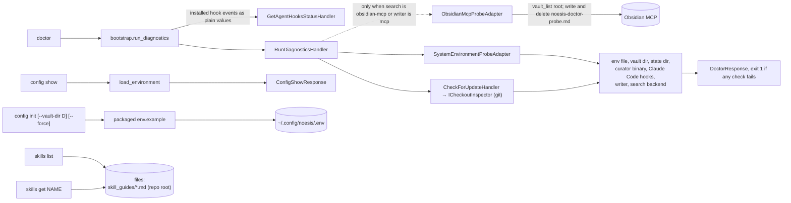

# `doctor`, `config`, `skills`

These have no bounded-context handler (except `doctor`'s host-level one) and never write
notes.

The `writer` check (between `claude_code_hooks` and `search_backend`) is ok with no MCP call
on the default `filesystem` writer; with `NOESIS_WRITER_BACKEND=mcp` it writes and deletes
`noesis-doctor-probe.md` at the vault root and fails (exit 1) when the server is unreachable or
refuses the write or the delete. The `vault` check fails on an unset vault only when a vault is required (writer or
search on `filesystem`).

The `search_backend` check makes no MCP call on the default `filesystem` backend. With
`obsidian-mcp` it lists the root of the vault Obsidian serves and compares the non-hidden
entry names with `NOESIS_VAULT_DIR`: unreachable server or a different vault fails the check
(exit 1) with a next step. Obsidian does not report which folder it serves, so equal root
listings are the evidence of "same vault".

The last check, `update`, compares the noesis checkout's git HEAD with origin's default
branch (the same query as `noesis update check`, with a 3 s budget). It never fails the
run: every verdict except `up_to_date` (`behind`, `ahead`, `diverged`, `unknown`) shows as a
`warn` line, with the fix command as the next step for `behind` and `diverged`. It may fetch
git objects into the checkout's `.git`, and moves no ref or file.

`skills get noesis` is what the installed agent skill stub runs, so the guide always
matches the installed version.

Back to [workflows](README.md).
