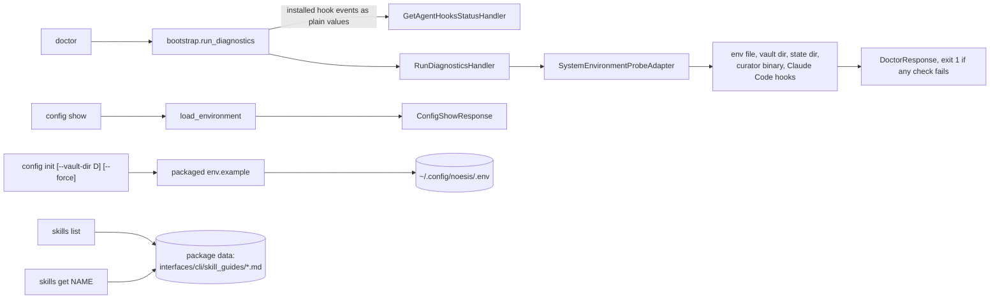

# `doctor`, `config`, `skills`

These have no bounded-context handler (except `doctor`'s host-level one) and never write
notes.

`skills get noesis` is what the installed agent skill stub runs, so the guide always
matches the installed version.

Back to [workflows](README.md).
