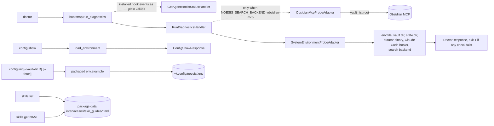

# `doctor`, `config`, `skills`

These have no bounded-context handler (except `doctor`'s host-level one) and never write
notes.

The `search_backend` check makes no MCP call on the default `filesystem` backend. With
`obsidian-mcp` it lists the root of the vault Obsidian serves and compares the non-hidden
entry names with `NOESIS_VAULT_DIR`: unreachable server or a different vault fails the check
(exit 1) with a next step. Obsidian does not report which folder it serves, so equal root
listings are the evidence of "same vault".

`skills get noesis` is what the installed agent skill stub runs, so the guide always
matches the installed version.

Back to [workflows](README.md).
