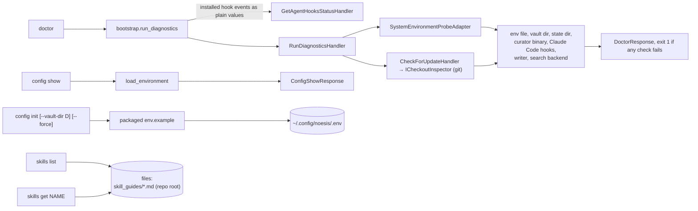

# `doctor`, `config`, `skills`

These have no bounded-context handler (except `doctor`'s host-level one) and never write
notes.

The `writer` check (between `claude_code_hooks` and `search_backend`) reports the filesystem
writer and makes no write; the `vault` check says whether files can land. The `vault` check
fails on an unset vault only when a vault is required. The `search_backend` check reports
`filesystem`. No check mentions Obsidian: the Obsidian MCP backends were removed, and a
configuration that still names one fails before `doctor` runs, with `CORE_006_REMOVED_BACKEND`.

The last check, `update`, compares the noesis checkout's git HEAD with origin's default
branch (the same query as `noesis update check`, with a 3 s budget). It never fails the
run: every verdict except `up_to_date` (`behind`, `ahead`, `diverged`, `unknown`) shows as a
`warn` line, with the fix command as the next step for `behind` and `diverged`. It may fetch
git objects into the checkout's `.git`, and moves no ref or file.

`skills get noesis` is what the installed agent skill stub runs, so the guide always
matches the installed version.

Back to [workflows](README.md).
